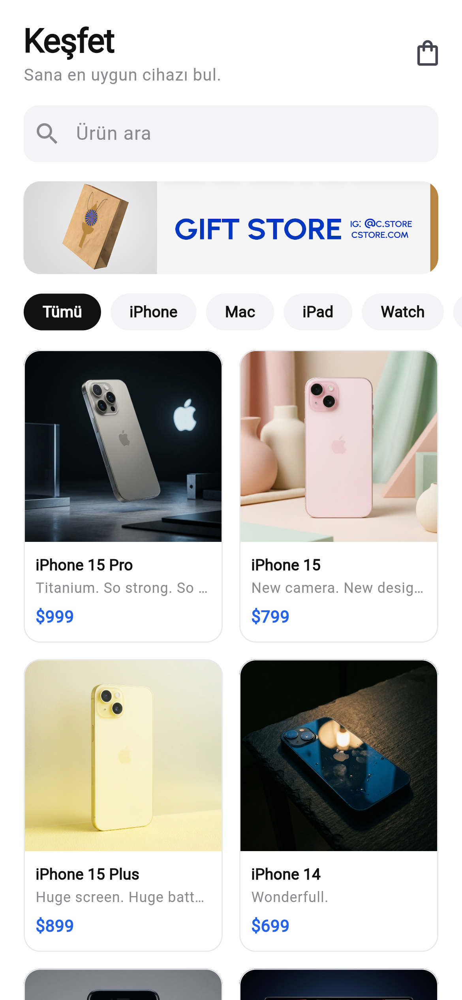
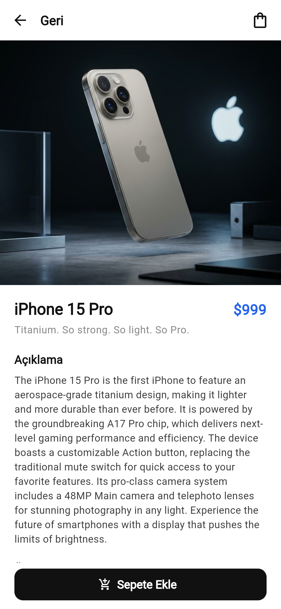
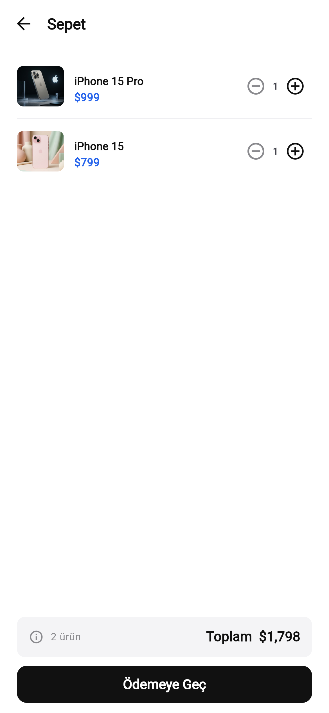
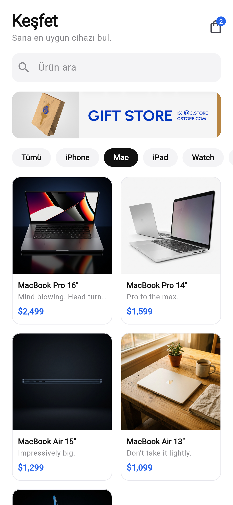
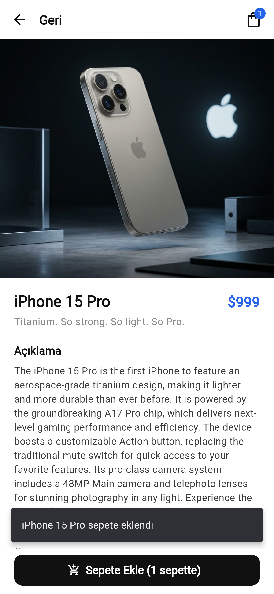
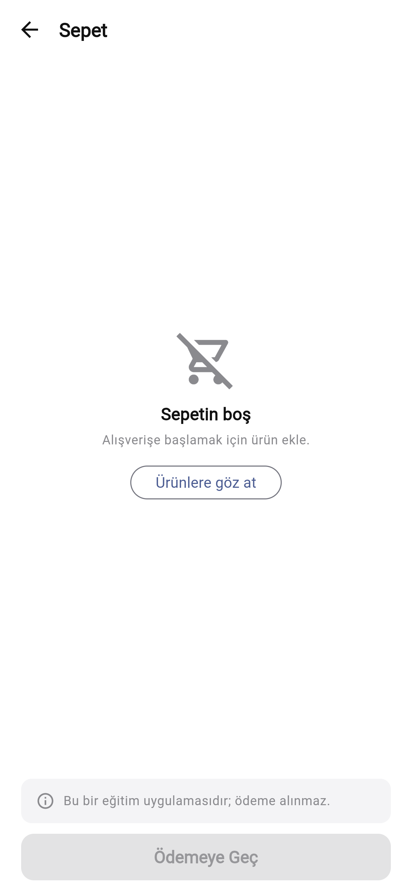

# Mini Katalog Uygulaması

🔗 **GitHub:** https://github.com/FFayken/mini_katalog

Flutter ile geliştirilmiş basit ama profesyonel görünümlü bir **ürün katalog uygulaması**.
Ürünleri grid görünümünde listeler, arama ve kategori filtresi sunar, ürün detayına geçer ve sepet simülasyonu yapar.

Flutter Günlük Eğitim — Proje Çıktısıdır (widget yapısı, sayfa geçişleri, temel UI tasarımı, veri modeli ve proje klasörleme).

| Ana sayfa | Ürün detayı | Sepet |
|---|---|---|
|  |  |  |

## Kullanılan Flutter Sürümü

| | Sürüm |
|---|---|
| Flutter | **3.50.0** (stable) |
| Dart | **3.14.0** |

Ek paket kullanılmamıştır; yalnızca Flutter SDK ile gelen `material.dart` kullanılır.

## Özellikler

- **Ana sayfa:** başlık, arama kutusu, banner, kategori filtreleri (Tümü / iPhone / Mac / iPad / Watch / Ses & Diğer) ve `GridView` ile ürün kartları
- **Ürün detayı:** büyük görsel (Hero animasyonu), fiyat, açıklama ve özellik kutucukları
- **Sayfa geçişleri:** `Navigator.pushNamed` + **Named Routes** (`/`, `/detail`, `/cart`)
- **Route Arguments:** seçilen `Product` nesnesi detay sayfasına argüman olarak taşınır
- **Sepet simülasyonu:** ekle / azalt / arttır, rozet ile ürün sayısı, toplam tutar, sipariş onay penceresi, boş sepet ekranı
- **Basit state yönetimi:** Flutter'ın kendi `ChangeNotifier` + `InheritedNotifier` sınıfları (ek paket yok)
- **JSON simülasyonu:** veriler `assets/data/products.json` dosyasından `rootBundle` ile okunur, `Product.fromJson` ile modele çevrilir
- **Asset yönetimi:** banner ve ürün görselleri `assets/images` altında, `Image.asset` ile gösterilir

## Çalıştırma Adımları

Gereksinimler: Flutter SDK 3.50+ ve bir cihaz/emülatör (Android Emulator, fiziksel Android cihaz veya Chrome).

```bash
# 1. Repoyu indirin
git clone https://github.com/FFayken/mini_katalog.git
cd mini_katalog

# 2. Bağımlılıkları alın
flutter pub get

# 3. Bağlı cihazları görün
flutter devices

# 4. Çalıştırın
flutter run                 # varsayılan cihaz (Android emülatör / telefon)
flutter run -d chrome       # tarayıcıda
```

Testler ve kod analizi:

```bash
flutter test      # model ve sepet birim testleri
flutter analyze
```

Android APK oluşturmak için (Android SDK kurulu olmalı):

```bash
flutter build apk --release
```

## Proje Yapısı

```
lib/
├── main.dart                     # Uygulama girişi, tema, CartScope
├── routes.dart                   # Named route'lar ve Route Arguments
├── models/
│   └── product.dart              # Product modeli (fromJson / toJson)
├── data/
│   └── product_repository.dart   # assets/data/products.json okuma
├── state/
│   └── cart.dart                 # Sepet (ChangeNotifier) + CartScope (InheritedNotifier)
├── screens/
│   ├── home_screen.dart          # Ana sayfa: arama, banner, kategori, GridView
│   ├── product_detail_screen.dart
│   └── cart_screen.dart
├── widgets/
│   ├── product_card.dart
│   └── cart_button.dart
└── theme/
    └── app_theme.dart
assets/
├── data/products.json            # Ürün verisi (JSON)
└── images/                       # banner.png ve products/*.png
test/
└── widget_test.dart              # Product ve Cart birim testleri
```

## Ekran Görüntüleri

| Ana sayfa | Kategori filtresi | Ürün detayı |
|---|---|---|
|  |  |  |

| Sepete eklendi | Sepet | Boş sepet |
|---|---|---|
|  |  |  |

> Ekran görüntüleri uygulamanın Flutter web derlemesinden, telefon boyutunda (390×844) alınmıştır.

## Veri Kaynağı

Ürün verileri ve görseller eğitim amaçlı [wantapi.com/products.php](https://wantapi.com/products.php) adresinden alınmıştır. Bu veriler gerçek bir e-ticaret altyapısını temsil etmez; ürün adları ve markalar sahiplerine aittir.
